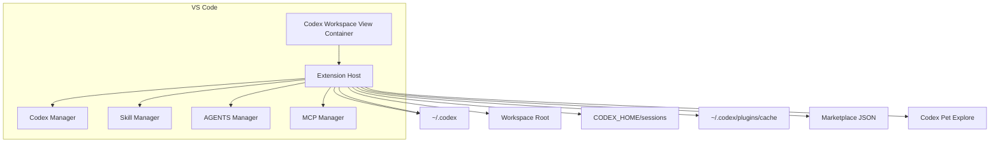

# 📘Codex Workspace 設計書

## 1. 🏷️システム概要

- **アプリ名**: `Codex Workspace`
- **種別**: VS Code 拡張
- **役割**: Codex の設定ファイル、Skills、Sub Agents、MCP Server、Templates、Pet、履歴・診断画面、Plugin 情報を VS Code 上で扱う
- **Codex Home**: `services/codexPaths.ts` の共通 resolver で、空白のみでない `CODEX_HOME` を優先する。未設定・空文字・空白のみは `~/.codex` を使い、Core、Skills、Agents、History、Plugins、同期、バックアップの参照先を統一する。Plugin キャッシュと Manager の画像許可パスも同じホーム配下の `plugins/cache` を使う。プロジェクト内の `.codex` / `.agents` と User Skills の `~/.agents/skills` は独立した保存場所として維持する。
- **主要 UI**:
  - View Container 配下の 6 Tree View
  - `Codex Pet Explore` の 1 WebviewView
  - `Codex Manager` / `Skill Manager` / `AGENTS Manager` / `MCP Manager` の 4 WebviewPanel

## 2. 🧰技術スタック

| 階層 | 技術・ライブラリ |
| --- | --- |
| 言語 | TypeScript |
| 実行基盤 | Node.js |
| 拡張 API | VS Code Extension API |
| ビルド | `esbuild` |
| Lint | `eslint` |
| 設定パース | `toml` |
| ローカライズ | `vscode-nls` |
| Webview アイコン | `@vscode/codicons` |
| テスト | Mocha + `@vscode/test-*` |

## 3. 🗂️プロジェクト構造

```txt
codex-workspace/
├── src/
│   ├── extension.ts
│   ├── commands/
│   │   ├── agentCommands.ts
│   │   └── fileCommands.ts
│   ├── models/
│   │   └── treeItems.ts
│   ├── services/
│   │   ├── agentConfigRepairService.ts
│   │   ├── agentConfigService.ts
│   │   ├── agentLocations.ts
│   │   ├── agentManagerPanel.ts
│   │   ├── agentManagerService.ts
│   │   ├── agentSyncCleanupService.ts
│   │   ├── configTomlOrganizerService.ts
│   │   ├── coreDiagnosticsService.ts
│   │   ├── coreManagerConfigService.ts
│   │   ├── disabledAgentsStore.ts
│   │   ├── fileNaming.ts
│   │   ├── fileOperations.ts
│   │   ├── fileTreeService.ts
│   │   ├── historyPanel.ts
│   │   ├── historyService.ts
│   │   ├── mcpManagerPanel.ts
│   │   ├── mcpManagerService.ts
│   │   ├── orchestrationService.ts
│   │   ├── mcpService.ts
│   │   ├── pluginService.ts
│   │   ├── petRateLimitService.ts
│   │   ├── petService.ts
│   │   ├── settings.ts
│   │   ├── skillConfigService.ts
│   │   ├── skillLocations.ts
│   │   ├── skillManagerPanel.ts
│   │   ├── syncService.ts
│   │   ├── templateService.ts
│   │   ├── webviewAssets.ts
│   │   └── workspaceStatus.ts
│   ├── views/
│   │   ├── agentExplorerProvider.ts
│   │   ├── codexTreeProvider.ts
│   │   ├── coreExplorerProvider.ts
│   │   ├── emptyExplorerProvider.ts
│   │   ├── fileExplorerProvider.ts
│   │   └── mcpExplorerProvider.ts
│   │   └── petExploreProvider.ts
│   └── test/
├── docs/
├── images/
└── package.json
```

## 4. 🧩機能設計

- **拡張起動**
  - `extension.ts` で 6 つの Tree View を生成する
  - Tree の選択状態、展開状態、Webview manager のインスタンスを保持する
  - コマンド登録は `registerFileCommands()` と `registerAgentCommands()` に委譲する

- **Core Explorer**
  - `coreExplorerProvider.ts` が `config.toml`、`AGENTS.md`、存在時のみ `AGENTS.override.md` を生成する
  - `config.toml` が不正な場合、warning アイコンと tooltip で状態を見せる
  - `profileConfigService.ts` の `listProfileConfigFiles()` で Profile V2 ファイルを追加し、既存の `codex-workspace.openFile` で開く。Profile 操作は Core Explorer に集約し、Manager に専用タブは設けない
  - 共通列挙処理は `codexPaths.ts` の resolver を利用し、Codex Home 直下の通常ファイル `<name>.config.toml` を名前順で返す。Base、空の名前、ディレクトリ、バックアップ、配下のサブディレクトリは対象外。ホームが存在しない場合は空の一覧を返し、他の読み取りエラーは呼び出し元へ返す

- **Commands / Skills / Templates Explorer**
  - `fileExplorerProvider.ts` がフォルダとファイルを列挙する
  - 隠しファイルは除外する
  - ソートは「folder 優先 + 名前昇順」
  - Skills のみ複数 root をフラットに表示する
  - Skills の `SKILL.md` と Skill root folder には有効/無効状態アイコンを付与する

- **Sub Agents Explorer**
  - `agentExplorerProvider.ts` が `getAgentLocations()` の結果から `*.toml` を列挙する
  - アイコン状態は `config.toml` に `[agents.<id>]` があるかどうかで決まる
  - tooltip と description に location label を付与する

- **MCP Server Explorer**
  - `mcpExplorerProvider.ts` が `readMcpServers()` の結果を表示する
  - `.env` 末尾の補助 block は一覧に出さない
  - Tree item クリックで `codex-workspace.mcp.toggle` を実行する

- **Codex Pet Explore**
  - `petExploreProvider.ts` が `WebviewViewProvider` として Explore 内にペット UI を提供する
  - `petService.ts` が `~/.codex/pets` を優先し、存在しない場合は `~/.codex/pet` を参照して `pet.json` を列挙する
  - `petService.ts` は `spritesheetPath` が pet フォルダ内の相対パスで実在する定義だけを採用し、`id` / `displayName` 欠損時はフォルダ名で補完する
  - Webview は `asWebviewUri` と `localResourceRoots` を使って pet フォルダ配下の画像だけを公開する
  - アニメーションは Webview 側の canvas で `192 x 208`、8 列固定のフレームを再生し、ドラッグ位置は provider が再描画中に保持する
  - `settings.ts` が `pet.enabled`、`pet.appServer.enabled`、`pet.rateLimitRefreshMinutes`、`pet.scale`、`pet.selectedPetId` を読み、`codexWorkspace.pet.*` も後方互換で参照する
  - `petRateLimitService.ts` が `codex app-server` を JSON-RPC で起動し、`account/rateLimits/read` の応答を `5h` / `1w` rate limit 表示モデルへ変換する

- **ファイル操作**
  - `fileCommands.ts` が add / rename / delete を担当する
  - Skills では header の root folder 追加時に location picker を表示する
  - Skills の folder 作成時は `references` / `scripts` / `assets` の候補を先に出し、候補外の入力も正規化してそのまま採用できる
  - 新規ファイル作成時の既定テンプレートは `templateService.ts` から取得する
  - 既存ファイル名と衝突した場合は `resolveUniqueName()` で `_1`, `_2` 形式へ退避する

- **Skill Manager**
  - `skillManagerPanel.ts` が単一 WebviewPanel を維持する
  - `skillConfigService.ts` が `SKILL.md` を再帰列挙し、frontmatter の `name` / `description` を読む
  - toggle は `setSkillEnabled()` により `[[skills.config]]` block を追加、更新、削除する
  - `enabled = true` は保存せず、block 不在を有効状態として扱う

- **Sub Agents 操作**
  - `agentCommands.ts` が add / edit / delete / enable / disable を担当する
  - 作成時はテンプレートをそのまま保存し、編集・有効化・設定整理では Agent TOML の内容を保持する。`name`、`description`、`developer_instructions` は自動補完しない
  - 作成、編集、有効化後は `upsertAgentConfigMetadata()` で `description` と `config_file` を実体へ同期する
  - 無効化時は block を `agents-disabled.json` に退避する
  - `agentDeclarationService.ts` は既存 `toml` パッケージの構文ノードと位置情報を使い、role の親・子テーブルをまとめて抽出する。インライン宣言は復元可能な role テーブルへ変換し、他の設定値を保持する
  - `agentFileStore.ts` は同一ディレクトリの一時ファイルへ書き込んでから置き換える。無効化は退避保存、設定保存の順、有効化は設定保存、退避削除の順に処理し、失敗時も復旧データを保持する。Manager と Explorer は失敗・未変更を成功通知しない
  - 同期や整理の前後では `agentConfigRepairService.ts` と `agentSyncCleanupService.ts` が `config.toml` を補正する
  - `agentManagerService.ts` は Base、`profileConfigService.ts` が列挙する Profile V2、認識済み Project の設定を TOML parser で直接解析し、`[agents.<role>]` と退避済み宣言から一覧モデルを作る
  - 行 ID は宣言元設定パスと role key の組とし、`config_file` は宣言元設定のディレクトリを基準に解決する。ファイル名から role key を推定しない
  - Manager の ON/OFF は行 ID から宣言元設定を特定して更新する。Base と Project は各設定ディレクトリの `.codex-workspace/agents-disabled.json`、Profile は `.codex-workspace/<name>.config.toml.agents-disabled.json` に退避する
  - Agent TOML の表示項目と `developer_instructions` は TOML parser で読み取る。参照ファイルなしは継承表示、`config_file` なしの Open は宣言元設定を開く。未登録ファイル列挙と設定レイヤーの完全合成は行わない
  - `agentManagerPanel.ts` は `Agents` / `Orchestration` の 2 タブを持つ Webview を提供する
  - Agents タブは左の一覧と右の詳細からなる list-detail レイアウトで、詳細ペインに `developer_instructions` の Markdown preview を HTML 描画する
  - `orchestrationService.ts` が workflow JSON の保存、読込、削除、一覧化、バリデーション、prompt 生成を担当する
  - workflow は `~/.codex/.codex-workspace/orchestrations/<workflowId>.json` に保存し、schema version 付きで管理する
  - `Orchestration` タブの canvas は workflow / agent / loop card と edge を保持し、Inspector で各 node/edge の詳細を編集する
  - prompt 生成は workflow グラフを解決し、現在の VS Code UI 言語に応じて日英プロンプトを組み立てる

- **MCP Manager**
  - `mcpManagerPanel.ts` が左 list / 右 form の Webview を提供する
  - `mcpManagerService.ts` が block 解析、バリデーション、保存、削除を行う
  - 保存時は管理対象キーを更新し、既存 block の未管理キーは維持する
  - 一覧は親サーバー block のみを対象とし、`env` / `http_headers` / `env_http_headers` / `tools.*` companion block は個別表示しない
  - `env` / `http_headers` / `env_http_headers` は companion block と inline table の両方から編集モデルへ取り込む
  - `tools.*` companion block は tool name ごとの `enabled` / `approval_mode` として編集モデルへ取り込む
  - UI で管理する companion block は `env` / `http_headers` / `env_http_headers` / `tools.*` のみで、未知の companion block は保存時も維持しつつ UI 編集対象外とする
  - 親サーバー rename / delete 時は companion block も追従し、`http_headers` などの inline table は保存時に companion block へ正規化されうる

- **Codex Manager**
  - `historyPanel.ts` がタブ付き Core WebviewPanel を提供する
  - History タブは `historyService.ts` から `HistoryIndex` を構築する
  - AGENTS Loading Chain は `coreDiagnosticsService.ts` が Global / Project tier の `AGENTS.override.md`、`AGENTS.md`、`project_doc_fallback_filenames` を診断し、`Active` / `Skipped` / `Missing` / `Error` 状態を作る
  - Trusted Directory、Feature Flags、Hooks は `coreDiagnosticsService.ts` と `coreManagerConfigService.ts` を用いる
  - Plugins タブは `pluginService.ts` で cache / marketplace / manifest 情報を集約し、`[plugins."<id>"]` の有効状態を切り替える

- **同期**
  - `syncService.ts` が Core / directory 単位の双方向同期を行う
  - Core 同期対象は `AGENTS.md`、`AGENTS.override.md`、`config.toml`
  - 隠しパスと `.codex-workspace` メタディレクトリは除外する
  - 管理状態は `.codex-workspace/codex-sync.json` に保存する
  - Sub Agents 同期後は `agentSyncCleanupService.ts` で `config.toml`、disabled store、sync state を補正する

- **`Organize config.toml`**
  - `extension.ts` のコマンド実装がバックアップを保存する
  - `repairAgentConfigEntries()` で Agent metadata を修復した後、`organizeConfigTomlContents()` で管理 block を再配置する

## 5. 🗃️データモデル

| エンティティ | 属性 | 型 | 説明 |
| --- | --- | --- | --- |
| `WorkspaceStatus` | `isAvailable` / `reason` / `isConfigInvalid` | boolean / string | ビュー利用可否 |
| `SyncSettings` | `codexFolder` / `promptsFolder` / `skillsFolder` / `templatesFolder` / `agentFolder` | object | 同期先設定 |
| `SkillLocation` | `kind` / `label` / `rootPath` / `createPath` / `priority` | object | Skills 保存場所 |
| `SkillRecord` | `id` / `name` / `description` / `skillPath` / `enabled` | object | Skill Manager 行 |
| `AgentLocation` | `kind` / `label` / `rootPath` / `createPath` / `priority` | object | Sub Agents 保存場所 |
| `AgentManagerRecord` | `id` / `name` / `description` / `model` / `reasoningEffort` / `sandboxMode` / `agentPath` / `configFile` / `location` / `enabled` / `previewContent` | object | AGENTS Manager 行 |
| `OrchestrationWorkflow` | `version` / `workflowId` / `name` / `description` / `finalOutputFormat` / `nodes` / `edges` / `createdAt` / `updatedAt` | object | Orchestration 保存モデル |
| `OrchestrationNode` | `nodeId` / `cardType` / `x` / `y` + card 種別ごとの属性 | object | canvas 上の card |
| `OrchestrationEdge` | `edgeId` / `sourceNodeId` / `targetNodeId` | object | card 間の接続 |
| `WorkflowValidationResult` | `errors` / `warnings` | object | workflow バリデーション結果 |
| `McpFormModel` | `id` / `transport` / `command` / `args` / `url` / `env` / `httpHeaders` / `envHttpHeaders` / `tools` / `required` / `startupTimeoutSec` / `toolTimeoutSec` / `enabledTools` / `disabledTools` / `enabled` | object | MCP Manager 編集モデル |
| `HistoryTurnRecord` | `turnId` / `sessionId` / `dateKey` / `userMessage` / `agentMessages` / `reasoningMessages` / `aiTimeline` | object | 会話履歴 1 タスク分 |
| `AgentsChainNode` | `status` / `kind` / `type` / `fileName` / `absolutePath` / `reason` | object | AGENTS Loading Chain 診断ノード |
| `TrustedDirectory` | `path` / `exists` / `reason` | object | Trusted Directory 表示モデル |
| `FeatureFlagRecord` | `key` / `enabled` / `maturity` / `maturityClass` / `description` | object | Feature Flags 表示モデル |
| `HookSourceRecord` | `id` / `layer` / `format` / `path` / `exists` / `active` / `entryCount` / `warning` | object | Hooks source 表示モデル |
| `HookEntryRecord` | `event` / `matcher` / `handlerType` / `handler` / `command` / `timeout` / `statusMessage` / `active` / `supported` | object | Hooks entry 表示モデル。`event` / `handlerType` は未知の名前も保持し、`handler` は元のHandler定義、`supported` は12 Event・4 Handler typeの両方が既知の場合のみtrue |
| `PluginRecord` | `id` / `displayName` / `version` / `marketplace` / `status` / `enabled` / `toggleDisabled` / `skills` / `mcpServers` / `apps` / `agents` | object | Plugins タブ表示モデル |
| `PetDefinition` | `id` / `displayName` / `description` / `spritesheetPath` / `petRootPath` / `spritesheetFsPath` | object | Pet 定義 |
| `PetSettings` | `enabled` / `appServerEnabled` / `rateLimitRefreshMinutes` / `scale` / `selectedPetId` | object | Pet 表示設定 |
| `PetRateLimitSnapshot` | `windows` | object | Pet rate limit 取得結果 |
| `PetRateLimitWindow` | `label` / `usedPercent` / `remainingPercent` / `resetAtLabel` / `isWarning` | object | Pet rate limit 表示モデル |

## 6. 🖥️画面設計

- **View Container**
  - `Codex Manager`
  - `Sub Agents`
  - `Skills`
  - `Commands`
  - `MCP Server`
  - `Templates`
  - `Codex Pet Explore`

- **Core ビュー**
  - `config.toml`
  - `AGENTS.md`
  - `AGENTS.override.md` は存在時のみ
  - タイトルバー: open folder / open Codex Manager / sync

- **Commands ビュー**
  - `~/.codex/prompts` 配下を表示
  - タイトルバー: add file / delete / rename / refresh / open folder / sync

- **Skills ビュー**
  - Project / Workspace / User / System の各 root をまとめて表示
  - タイトルバー: add root folder / delete / rename / refresh / open folder / sync / Skill Manager
  - item context: add folder / add file

- **Templates ビュー**
  - `~/.codex/codex-templates` 配下を表示
  - タイトルバー: add root folder / add file / delete / rename / refresh / open folder / sync
  - item context: add folder / add file

- **Sub Agents ビュー**
  - `getAgentLocations()` の各 root 配下 `*.toml` を表示
  - タイトルバー: add / edit / delete / refresh / open folder / sync / AGENTS Manager

- **MCP Server ビュー**
  - MCP サーバー一覧のみを表示
  - タイトルバー: refresh / MCP Manager

- **Codex Pet Explore**
  - タイトルバー: select pet / connect app server / disconnect app server / refresh
  - 本体: draggable pet canvas
  - 補助表示: 接続中かつ rate limit 取得時のみ吹き出しを約 5 秒表示

- **Skill Manager**
  - 上部: search / clear / refresh
  - 本体: list row
  - 行要素: icon / title / description / path / location / switch / open button

- **AGENTS Manager**
  - タブ: Agents / Orchestration
  - Agents タブ
    - 上部: search / clear / refresh
    - 本体: 左 list / 右 detail
    - 一覧行要素: icon / name / description / model / reasoningEffort / sandboxMode / path / location / switch / open button
    - 詳細要素: model / reasoningEffort / sandboxMode / location / path / `developer_instructions` preview
  - Orchestration タブ
    - 上部: saved workflow select / new / open folder / save / delete
    - 中央: workflow / agent / loop card を置く canvas
    - 右: Inspector
    - 下部: prompt preview / copy
    - card 編集: workflow の名前、説明、最終出力形式、agent の入力・期待出力・完了条件、loop の最大試行回数・受け入れ条件

- **MCP Manager**
  - 上部: search / clear / refresh
  - 左ペイン: server list, add / delete / save / cancel
  - 右ペイン: server detail form
  - 詳細フォーム: `env` / `httpHeaders` / `envHttpHeaders` は key-value rows、`tools` は tool name + enabled + approval_mode rows

- **Codex Manager**
  - タブ: History / AGENTS Loading Chain / Trusted Directory / Feature Flags / Hooks / Plugins
  - History: 検索バー + 左一覧 + 右プレビュー
  - AGENTS Loading Chain: 左一覧 + 右詳細
  - Trusted Directory: add / remove / refresh
  - Feature Flags: CLI の `features list` を非同期実行して一覧を表示し、`features enable` / `features disable` の完了後に再取得する
  - Feature CLI は共通 resolver の Base ホームを `CODEX_HOME` に設定し、一時作業ディレクトリから実行する。15 秒のタイムアウトと 1 MiB の出力上限を設け、失敗を Webview に表示する
  - Windows は `codex.exe` を優先し、未検出時のみ `codex.cmd` を試す。Feature key は検証し、CLI に存在しないキーは更新しない
  - 古いFeature設定の削除は、CLI未掲載または `removed` の設定だけを確認ダイアログで提示する。確認時のファイル内容を保持し、削除直前にCLI一覧とファイルを再検証する
  - 単一行のboolean設定を局所削除し、削除前後のTOML解析結果が対象キー以外で一致することを検証する。未保存の編集、設定変更、未対応形式では書き込まない
  - Featureの切り替えと削除は同じキューで順番に実行する。削除後は再取得し、古い非同期取得結果による表示の上書きを防ぐ
  - Hooks: summary + source list + entry list
    - JSON / inline TOML は共通のHook分類処理で読み、未知のEvent / Handlerを除外しない。inlineは既存のTOMLライブラリで解析する
    - 未知定義は `Unknown` の読み取り専用表示、command以外と未知定義の詳細はエスケープしたJSONで表示する。Hook定義の書き換え・実行は行わず、既存のファイルopen / create操作を維持する
  - Plugins: 検索 + 左一覧 + 右詳細

## 7. 🗺️システム構成図



## 8. 🔌外部インターフェース

- **ファイルシステム**
  - `~/.codex`
  - `~/.codex/.codex-workspace/orchestrations`
  - `workspace/.agents/skills`
  - `workspace/.codex/skills`
  - `workspace/.codex/agents`
  - `workspace/.agents/agents`
  - `~/.agents/skills`
  - `~/.codex/plugins/cache`
  - `~/.agents/plugins/marketplace.json`
  - `workspace/.agents/plugins/marketplace.json`
  - `workspace/.claude-plugin/marketplace.json`
- **VS Code API**
  - Tree View
  - Command
  - Quick Pick / InputBox / Message
  - WebviewPanel
  - `vscode.open`
  - `vscode.env.openExternal`
- **設定**
  - `codex-workspace.*` の 12 設定キー
- **履歴入力**
  - `rollout-*.jsonl`

## 9. 🧪テスト戦略

- `src/test/` に単体テストを配置する。
- 主な確認対象:
  - `workspaceStatus.test.ts`: 利用可否判定
  - `viewTitleMenus.test.ts`: ビュータイトルメニュー寄与
  - `agentMenus.test.ts`: Agent メニュー寄与
  - `skillLocations.test.ts` / `agentLocations.test.ts`: 保存場所解決
  - `skillConfigService.test.ts` / `agentConfigService.test.ts`: `config.toml` 更新
  - `agentConfigRepairService.test.ts` / `disabledAgentsStore.test.ts`: Agent metadata 修復と disabled store
  - `orchestrationService.test.ts` / `agentManagerPanel.test.ts`: workflow 保存・検証・prompt 生成と AGENTS Manager orchestration UI
  - `mcpService.test.ts` / `mcpManagerService.test.ts` / `mcpManagerPanel.test.ts`: MCP 読み書きとパネル挙動
  - `historyService.test.ts` / `historyPanel.test.ts`: 履歴抽出と Core Webview state
  - `coreDiagnosticsService.test.ts` / `coreManagerConfigService.test.ts`: Core 診断と設定更新
  - `pluginService.test.ts`: Plugin manifest / marketplace 読み取り
  - `petService.test.ts` / `settings.test.ts`: Pet 定義と設定値の正規化
  - `templateService.test.ts`: テンプレート候補の列挙
  - `syncService.test.ts` / `syncCommands.test.ts`: 双方向同期
  - `configTomlOrganizerService.test.ts`: `config.toml` 整理

## 10. 🛡️非機能要件

- **可用性**
  - `config.toml` が壊れていても Core ビューから修復導線を残す
- **保守性**
  - Explorer Provider と更新サービスを分離する
  - manager panel ごとに責務を分ける
- **一貫性**
  - Webview は VS Code テーマ色と codicon を使う
  - Skills / Agents / MCP の ON/OFF 表現を統一する
- **安全性**
  - 破壊操作は確認ダイアログを出す
  - User Agents 削除時のみ追加警告を出す
  - Plugin toggle は manifest 不備または config 不正時に無効化する
